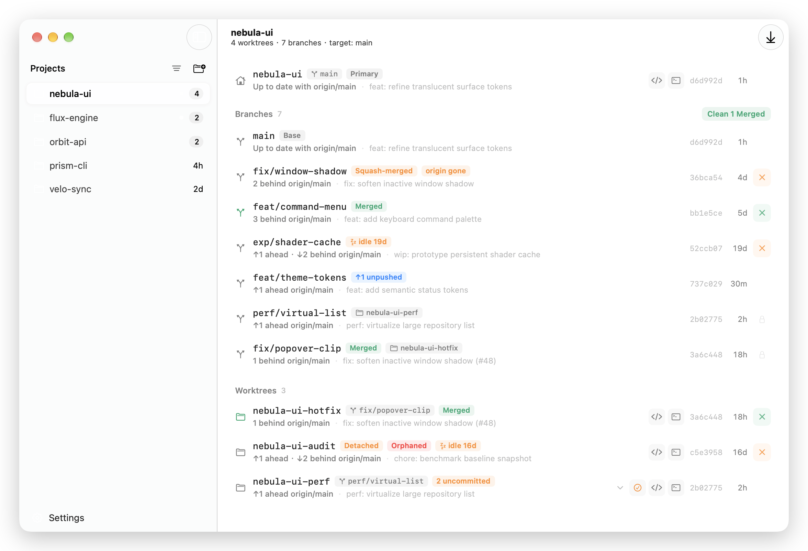

<p align="center">
  
</p>

<h1 align="center">Grove</h1>

<p align="center">
  A lightweight, native macOS dashboard for managing <b>Git worktrees</b> and <b>local branches</b> — surfacing merged checkouts, idle commits, and orphaned detached HEADs at a glance.
</p>

<p align="center">
  
</p>

## Install (Apple Silicon)

### Option 1: Homebrew (Recommended — No Gatekeeper Warning)

```bash
brew tap yeoleobun/tap
brew trust yeoleobun/tap 2>/dev/null || true
brew install --cask yeoleobun/tap/grove
```

### Option 2: One-Line Terminal Installer

```bash
curl -fsSL https://raw.githubusercontent.com/yeoleobun/Grove/main/scripts/install.sh | zsh
```

### Option 3: Manual `.dmg` Download

1. Download **`Grove-macos-arm64.dmg`** from the [latest GitHub Release](https://github.com/yeoleobun/Grove/releases/latest) and drag **`Grove.app`** into `/Applications`.
2. Clear the browser quarantine flag once before first launch:
   ```bash
   xattr -cr /Applications/Grove.app
   open /Applications/Grove.app
   ```

## Features

- **Unified Single-Page Repository View:** Displays your primary checkout (`main` worktree) and **Branches** first, followed by linked **Worktrees** — no tab switching or commit-graph clutter.
- **100% Deterministic Git Tags:** Every badge reflects pure Git truth against your integration target (`main` / `origin/main`):
  - **`Merged` / `Squash-merged`:** Safe ancestry-merged items get a 1-click green cleanup action (`Clean N Merged`); squash/rebase merges explain why `git branch -D` is needed before confirming.
  - **`idle Nd` (`>= 14d`):** Tracks stale commit timestamps uniformly across standalone local branches, linked worktrees, and detached `HEAD` checkouts.
  - **`Detached` & `Orphaned`:** Highlights detached `HEAD` worktrees whose commits are not reachable from any branch.
  - **`N uncommitted` / `Conflict` / `↑N unpushed` / `origin gone`:** Surfaces dirty working trees (click to inspect changed files inline), unpushed commits, and deleted upstream PR refs.
- **Worktree-Scoped Editor & Terminal Launchers:** Open any individual worktree folder directly in **VS Code**, **Cursor**, **Zed**, **Windsurf**, **Antigravity**, **Xcode**, or **Terminal / iTerm / Ghostty / Warp**.
- **Safe Cleanup & Rescue Refs:** Re-verifies working-tree status, untracked/ignored files, locks, and commit ancestry before removal. Optional **Preserve commits** writes durable recovery refs under `refs/grove/rescued/<id>` so unmerged commits survive Git GC:
  ```bash
  git for-each-ref refs/grove/rescued/
  git branch recovered refs/grove/rescued/<id>
  ```
- **Zero Background Polling:** Uses 0% CPU when closed or idle and automatically refreshes in ~0.2s whenever you open or focus the Dashboard window.
- **Serverless In-App Self-Update:** Checks GitHub Releases (`releases/latest`) and offers a 1-click **`Update to vX.Y.Z`** action in the sidebar, menu bar, and Settings that SHA-256 verifies, unquarantines, swaps `Grove.app`, and relaunches automatically.

## Prerequisites

- **macOS 26.0+** on Apple Silicon (`arm64`)
- `git` installed on `PATH` (Xcode Command Line Tools or Homebrew)

## Build & Test from Source

```bash
make test
make app
open dist/Grove.app
```

Scan folders and editor/terminal preferences are stored locally in `~/Library/Application Support/Grove/config.json`.

## Project Structure

- `Assets/` — App bundle icon (`AppIcon.png`) and preview screenshot (`Screenshot.png`)
- `Sources/Grove/` — Native SwiftUI Liquid Glass split-view UI, menu bar tree indicator, and contextual safety sheets
- `Sources/GroveCore/` — `ProjectScanner`, `GitWorktreeService`, `GitHistoryService`, and `UpdateService`
- `Tests/GroveTests/` — End-to-end Git worktree, branch hygiene, force-delete, detached-HEAD rescue, and updater tests
- `scripts/` — App bundle + `.zip`/`.dmg` packager (`build_app.sh`), 1-line installer (`install.sh`), and `.icns` generator (`generate_icon.swift`)
- `.github/workflows/release.yml` — Automated Apple Silicon (`arm64`) release pipeline & Homebrew tap updater on `v*` tags
